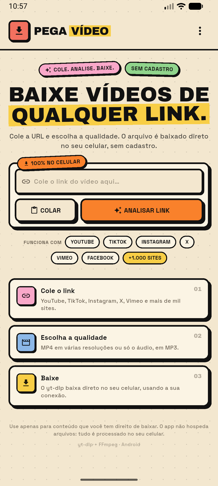
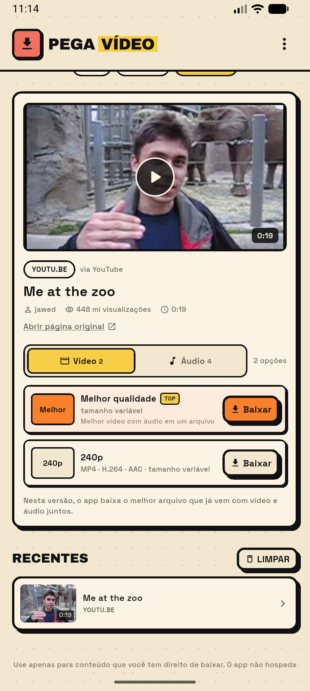
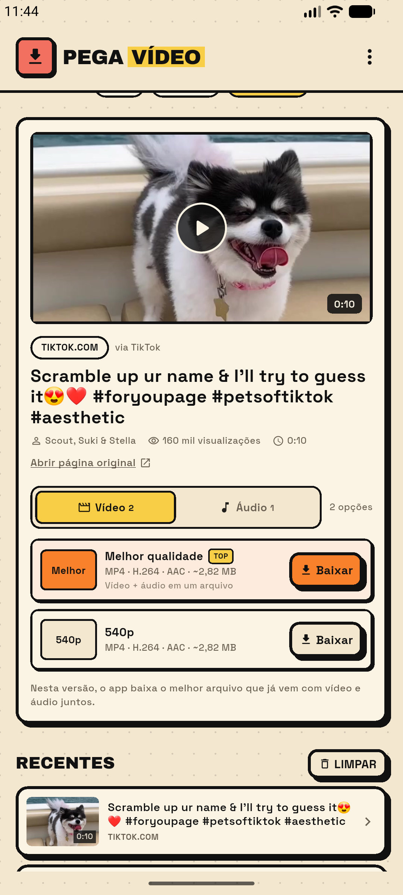

# Pega Vídeo (Android)

App Flutter para baixar vídeos e áudio **direto no celular**, usando o IP da sua conexão — sem servidor, sem Vercel e sem o seu computador no meio.

<p align="center">
  
  
  
</p>

## O que ele faz

- Cole uma URL de YouTube, TikTok ou de outros sites suportados pelo yt-dlp.
- Mostra título, autor, thumbnail, duração e visualizações.
- Lista as qualidades que já vêm com **vídeo + áudio juntos** e as faixas de áudio originais.
- Baixa no próprio aparelho com progresso, ETA e botão de cancelar.
- Permite abrir ou compartilhar o arquivo salvo.
- Guarda um histórico dos últimos links no aparelho.
- Mesmo visual neobrutalista do Pega Vídeo web: creme, laranja, amarelo, sombras duras e tipografia Archivo Black + Space Grotesk.

## Instalar

Baixe o APK mais recente na aba **Releases**:

- `app-arm64-v8a-release.apk` — celulares Android modernos (recomendado).
- `app-armeabi-v7a-release.apk` — aparelhos mais antigos.

No Android, permita a instalação de fontes desconhecidas para o navegador/gerenciador de arquivos. O APK é assinado com a chave de debug do projeto, adequada para uso pessoal e testes.

## Como funciona

- **Android:** [youtubedl-android](https://github.com/JunkFood02/youtubedl-android) via plugin [extractor](https://pub.dev/packages/extractor) roda o yt-dlp e o FFmpeg embutidos no aparelho.
- **YouTube:** yt-dlp no celular, com o IP da operadora/Wi-Fi.
- **TikTok:** extrator HTTP direto da página (com os cookies necessários) e fallback para o yt-dlp.
- **Arquivos:** ficam em `Android/data/com.myckwilliam.pegavideo/files/PegaVideo` e podem ser abertos ou compartilhados pelo próprio app.
- Nenhum link, cookie ou vídeo sai do aparelho para um servidor nosso.

## Rodar / buildar

Requisitos: Flutter 3.47+, JDK 17 e Android SDK 36.

```bash
flutter pub get
flutter run
flutter build apk --release --split-per-abi
```

Os APKs ficam em `build/app/outputs/flutter-apk/`.

## Limitações desta versão

- **Somente Android** por enquanto. No iOS, o yt-dlp precisaria de outra engine/embutimento (e a App Store é bem mais restrita).
- O app baixa **arquivos que já têm vídeo + áudio juntos**; streams separados (YouTube 1080p+, por exemplo) não são mesclados nesta versão. Em troca, o download é mais rápido e não depende de um FFmpeg externo.
- MP3 convertido ainda não é oferecido; o áudio é baixado no formato original (M4A/WebM/Opus).
- Posts de fotos/slideshow do TikTok não são suportados.
- Alguns sites podem bloquear o extrator ou exigir cookies/login; o menu tem **Atualizar yt-dlp** para tentar acompanhar mudanças.

Use apenas para conteúdo que você tem direito de baixar. O app não hospeda nem distribui arquivos.

## Créditos

- [yt-dlp](https://github.com/yt-dlp/yt-dlp)
- [youtubedl-android](https://github.com/JunkFood02/youtubedl-android) (GPL-3.0)
- [extractor](https://pub.dev/packages/extractor)
- Fontes: Archivo Black e Space Grotesk (Google Fonts, OFL)
- Visual base: Pega Vídeo web (mesmo autor)

Licença: GPL-3.0 (o youtubedl-android, embutido no APK, é GPL-3.0).
